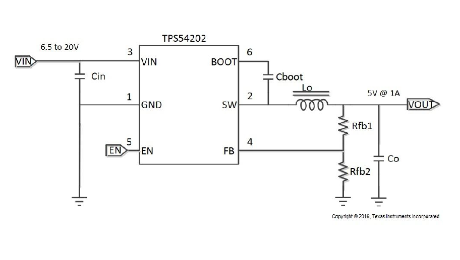
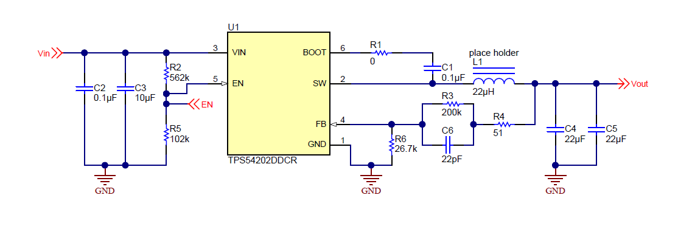

## 1. Düşürücü (Step-Down) Dönüştürücü Tasarımına Genel Bakış (Overview of the Step-Down Converter Design)

Bu tasarım, senkron bir düşürücü anahtarlamalı regülatör (Synchronous Buck Converter) olan TPS54202 entegresine (IC) dayanmaktadır. Basitleştirilmiş devre şeması (görsel: sch_simplified_circuit.png), (6.5V - 20V) arasında değişen sürekli giriş gücünün (5V) ve (1A) değerinde kararlı ve sürekli bir çıkış gerilimine dönüştürülmesi için temel bağlantıyı göstermektedir.

### 1.1. İç Yapı: Senkron Anahtarlama ve Doğrusal Dağılım Karşılaştırması
Bu devre, fazla enerjiyi ısı olarak dağıtarak gerilimi düşüren ve bu nedenle büyük bir enerji israfına yol açan klasik doğrusal regülatörlerden (LDO'lar) kökten farklıdır. 
Buna karşılık, TPS54202 entegresi dahili senkron anahtarlama mekanizmasına dayanır. Bu mekanizma, çip içine entegre edilmiş iki adet (MOSFET) tipi transistöre dayanır:
1. **Üst Transistör (High-Side MOSFET).**
2. **Alt Transistör (Low-Side MOSFET).**

Bu iki transistör dönüşümlü olarak çalışır; biri açıldığında (ON) diğeri kapanır (OFF) ve tersi de geçerlidir. Bu hızlı ve hesaplanmış darbeler, enerjinin girişten çıkışa (%90 - %95) varan olağanüstü bir verimlilikle aktarılmasını sağlar. Bu durum soğutuculara (heatsink) olan ihtiyacı ortadan kaldırır ve devrenin genel boyutunun küçültülmesine olanak tanır.

### 1.2. Başlatma Devresi ve Kondansatörünün (Bootstrap Capacitor - Cboot) Detaylı Analizi
Başlatma kondansatörü (`Cboot`), üst transistörün (High-Side MOSFET) sürekli ve verimli çalışmasını sağlamak için kritik bir bileşendir. İşlevini anlamak için iç devrenin analiz edilmesi gerekir:
- **Fiziksel Konum:** Kondansatör harici olarak `BOOT` başlatma pini ile `SW` anahtarlama pini arasına bağlanır. Mühendislik açısından bu bağlantı, kondansatörün üst transistörün Geçit (Gate) ve Kaynak (Source) uçları arasına bağlanmasını temsil eder. Giriş gerilimi ($V_{IN}$) doğrudan bu transistörün Dren (Drain) ucuna bağlanır.
- **Şarj Aşaması:** Devre üst transistörü kapatıp alt transistörü açtığında (Low-Side = ON), `SW` pininin gerilimi (üst transistörün kaynağını temsil eder) sıfıra (GND) çekilir. Tam bu anda entegre, `Cboot` kondansatörünü sabit bir gerilimle (dahili spesifikasyonlara göre yaklaşık 5V) şarj eder.
- **Yükseltme ve Çalıştırma Aşaması (Bootstrapping):** Üst MOSFET transistörünün çalışabilmesi için geçit (Gate) geriliminin, kaynak (Source) geriliminden çalışma değeri kadar (kondansatörün depoladığı 5V) yüksek olması gerekir.
- **Açıklayıcı Örnek:** Üst transistörü etkinleştirmek için çalışma darbesi geldiğinde, giriş gerilimi (örneğin 12V olduğunu varsayalım) Drain'den geçerek Source ucunda (`SW` pini) görünür. Source artık 12V'ta olduğundan ve kondansatör önceden 5V ile şarj edildiğinden, `BOOT` pini üzerinden Geçide (Gate) uygulanan toplam gerilim (12V + 5V = 17V) olacak şekilde itilir.
- **Sonuç:** Kaynak (Source) 12V'ta iken Geçitte (Gate) 17V olması, gerekli gerilim farkını ($V_{GS} = 5V$) korur. Bu, üst transistörün çalışma döngüsü (Duty Cycle) boyunca kapanmadan tam etkin (Fully Enhanced) durumda kalmasını garanti eder.

### 1.3. Sinyal Yumuşatma Aşaması ve Çıkış Filtresi (Output LC Filter)
`SW` anahtarlama pininde üretilen sinyal, tam giriş gerilimi (örneğin 12V veya 20V) ile sıfır volt arasında sürekli salınan bir kare dalgadır (Square Wave). Bu darbelerin ortalama gerilim değeri, TPS54202 entegresindeki dahili kontrol döngüsü tarafından otomatik olarak ayarlanan ve giriş gerilimindeki dalgalanmalardan bağımsız olarak tam (5V)'luk bir ortalama gerilim elde etmeyi sağlayan "çalışma döngüsüne" (Duty Cycle) bağlıdır.

Bununla birlikte, yüksek oranda alternatif dalgalanmalar (AC Ripples) ve yüksek frekanslı gürültü (High-Frequency Noise) içerdiğinden, bu darbe dalgası hassas yükleri doğrudan beslemek için uygun değildir. Saf ve kararlı bir doğru akım (DC) elde etmek için, Bobin ($L_O$) ve çıkış kondansatöründen ($C_O$) oluşan bir alçak geçiren filtre (LC Low-Pass Filter) tasarlanmıştır:

- **Bobinin ($L_O$) Rolü:** Bobinin fiziksel prensibi, akımdaki ani değişimlere karşı gösterilen dirence (empedans) dayanır.
    * **İletim Durumunda (ON):** Akım geçtiğinde bobin, enerjiyi yüke iletir ve fazlasını "manyetik alan" olarak depolar.
    * **Kesim Durumunda (OFF):** `SW` pininden gerilim kesildiğinde, manyetik alan kademeli olarak çökmeye başlar ve geçici bir güç kaynağı gibi davranarak akımı sürekli olarak çıkışa doğru iter. Bu mekanizma, akımın aniden kesilmesini önler ve darbeleri yumuşatır; bobin, alternatif frekanslara (AC) karşı yüksek bir empedans gösterirken doğru akım bileşeninin (DC) geçmesine izin verir.
- **Çıkış Kondansatörünün ($C_O$) Rolü:** Bobinin yumuşatmadaki verimliliğine rağmen, bazı hızlı alternatif dalgalanmalar sızabilir. Burada, fiziksel olarak alternatif akımlara (AC) karşı çok düşük, doğru akımlara (DC) karşı ise sonsuz bir empedansa sahip olmasıyla öne çıkan kondansatörün rolü ortaya çıkar. Kondansatör hızlı bir deşarj yolu (Shunt Path) görevi görür; kalan alternatif dalgalanmaları emerek doğrudan toprağa (GND) iletir ve yüke ulaşmalarını engelleyerek sonuçta çıkışın tam (5V) değerinde saf bir doğru gerilimde sabitlenmesini sağlar.

### 1.4. Geri Besleme Yolu ve Regülasyon Döngüsü (Feedback Loop and Voltage Regulation)
Çıkış geriliminin farklı çalışma koşulları altında (5V)'ta sabit ve kararlı kalmasını sağlamak için entegre, harici olarak geri besleme dirençleri ($R_{FB1}$ ve $R_{FB2}$) aracılığıyla yönetilen bir "kapalı döngü kontrol" (Closed-Loop Control) sistemine dayanır.

- **Gerilim Bölücü (Voltage Divider):** Tüm çıkış gerilimi (5V) hassas entegreye doğrudan verilemez. Bu nedenle, dirençler ($R_{FB1}$ ve $R_{FB2}$) bir gerilim bölücü ağı oluşturarak toplam çıkış geriliminden hassas bir oranda küçültülmüş güvenli bir "örnek" (Sample) alır ve bunu `FB` geri besleme pinine (4. Pin) iletir.
- **Sürekli Regülasyon ve Karşılaştırma Mekanizması:** Entegre, içinde silikon yapısına kazınmış çok hassas bir referans gerilim değerine (bu çipte $0.596V$) sahip olan "Hata Yükselteci" (Error Amplifier) adı verilen kritik bir bloğa sahiptir. Hata yükselteci, `FB` pininden gelen gerilimi bu referans gerilimle anlık ve sürekli olarak karşılaştırır:
    1. **Normal Çalışma ve Regülasyon Durumunda:** Eğer yük artarsa (örneğin projedeki bileşenler daha yüksek bir akım çekerse), çıkış gerilimi 5V'un biraz altına düşmeye çalışacaktır. Sonuç olarak, `FB` pinindeki gerilim de düşecektir. Entegre bu düşüşü derhal tespit eder ve tam 5V'luk çıkışı yeniden sağlamak için daha fazla güç pompalamak üzere anahtarlama darbelerinin genişliğini artırır (Duty Cycle'ı genişletir). Yük azaldığında ise bunun tersi geçerlidir.
    2. **Hata ve Koruma Durumlarında (Fault Conditions):** Kısa devre (Short Circuit) veya aşırı yük (Overload) durumunda, çıkış gerilimi çok keskin bir şekilde düşecek ve bu da `FB` pinine ulaşan gerilimde anormal ve büyük bir düşüşe yol açacaktır. Bu hatalı değer referans gerilimle karşılaştırıldığında entegre, sistemi tehdit eden bir tehlike olduğunu fark eder ve katı koruma önlemleri alır (transistörlerin çalışmasını bir süreliğine durdurmak veya güvenli yeniden başlatma modunu etkinleştirmek gibi). Bu önlemler, daha sonra çipin iç yapısı bölümünde detaylandırılacak olan dahili koruma blokları tarafından yönetilir.

### 1.5. Giriş Aşaması ve Dekuplaj Kondansatörleri (Input Stage and Decoupling Capacitors - CIN)
Giriş aşaması, `VIN` pinine (3. Pin) ve toprağa `GND` (1. Pin) bağlı ana güç yolundan (6.5V ila 20V) oluşur. Bu iki pin arasına yerleştirilen giriş kondansatörü ($C_{IN}$), yokluğu veya yanlış yerleştirilmesi herhangi bir anahtarlamalı devrenin arızalanmasının başlıca nedeni olan bir bileşendir. Bu kondansatör üç kritik mühendislik rolü üstlenir:

1. **Kaynaktaki Parazitlerin Filtrelenmesi (DC Filtering):** Kondansatör, ana güç kaynağından gelen dalgalanmaları (Ripples) veya gürültüyü (Noise) emerek ve bu alternatif safsızlıkları doğrudan toprağa ileterek entegreye saf ve sürekli bir akımın ulaşmasını sağlayan bir ön filtre görevi görür.
2. **Yerel Enerji Deposu (Local Energy Reservoir):** Üst transistörün (High-Side MOSFET) hızlı anahtarlanmasına dayanan entegrenin çalışma doğası gereği, kaynaktan büyük ve ani darbeler şeklinde akım çekilir. Uzun güç kabloları bu hızlı anlık çekime yanıt veremez; işte burada kondansatör, bu eksikliği telafi etmek için anında deşarj olan bir yedek enerji deposu olarak çalışır ve giriş geriliminde ani bir düşüş (Voltage Drop) yaşanmasını engeller.
3. **Endüktif Gürültünün ve Elektromanyetik Girişimin (EMI) Bastırılması:** Devre kartı üzerindeki bakır yollar (Traces) ve entegrenin iç telleri, küçük bobinler gibi davranmalarına neden olan "parazitik endüktansa" (Parasitic Inductance) sahiptir. Yüksek akım çok hızlı bir şekilde anahtarlanıp kesildiğinde, ters gerilimler ve yüksek frekanslı elektromanyetik kirlilik oluşur. Giriş kondansatörü bu sıçramaları (Spikes) emer ve yayılarak devrenin geri kalanını bozmasını engeller.

- **Yerleşimin Kritik Önemi (Layout Placement):** 
Üçüncü işlevi verimli bir şekilde gerçekleştirebilmek için, mühendislik açısından giriş kondansatörleri fiziksel olarak entegrenin `VIN` ve `GND` pinlerine mümkün olan en yakın yere yerleştirilmelidir. Onaylanmış pratik tasarımda, genellikle paralel iki kondansatör kullanılır: enerji deposu olarak daha büyük kapasiteli bir kondansatör ve yüksek frekansları ile son derece yüksek elektromanyetik gürültüyü emmek için entegreye tam olarak bitişik yerleştirilen küçük kapasiteli (örneğin 0.1µF) bir seramik kondansatör.

### 1.6. Sonuç ve Pratik Tasarıma Geçiş (Conclusion & Transition to Practical Design)
Önceki basitleştirilmiş şema, senkron anahtarlama mekanizmasından başlayarak başlatma devresi (Bootstrap), çıkış filtresi (LC Filter) ve regülasyon döngüsüne kadar TPS54202 entegresinin temel işlevlerinin net bir şekilde anlaşılmasını sağlamıştır. 

Bununla birlikte, bu dönüştürücüyü yüksek güvenilirlik gerektiren gerçek bir çalışma ortamında (bu projedeki yapay zeka kamerasını çalıştırmak gibi) uygulamak için basitleştirilmiş devre yeterli değildir. Elektromanyetik uyumluluk (EMI Compliance), giriş akımı için daha yüksek stabilite ve özel koruma (çalışma gerilimi için kesin bir eşik belirlemek gibi) gereklidir. 

Bu nedenle, sonraki bölümlerde temel uygulama devresinden, kararlı ve optimum bir performans sağlamak için Etkinleştirme Gerilimi Bölücü ağı (Enable Divider) ve Çift Dekuplaj Kondansatörleri (Dual Decoupling Capacitors) gibi gelişmiş mühendislik eklentileri içeren referans tasarım modülünün (TIDA-00946) tam ve ayrıntılı şematik analizine geçilecektir.

## 2. Pratik Şemanın Ayrıntılı Analizi (Detailed Practical Schematic Analysis)

Yukarıdaki şema (görsel: tida00946_full_schematic.png), TIDA-00946 değerlendirme modülünün (evaluation board) tam ve pratik tasarımını göstermektedir. Bu tasarım, fiili performansı artırmak, elektromanyetik girişimi (EMI) azaltmak ve zorlu çalışma koşulları altında devrenin kararlılığını sağlamak amacıyla hassas mühendislik eklentileri içerir.

### 2.1. Gelişmiş Başlatma Devresi ve Sönümleme Direnci (Advanced Bootstrap & Damping Resistor)
Basitleştirilmiş şemada açıklandığı gibi, üst MOSFET transistörünü iletimde (ON) tutmak için bir başlatma kondansatörü ($C1$, $0.1\mu F$ kapasiteli) kullanılır. Ancak bu pratik tasarımda göze çarpan nokta, bu kondansatöre seri olarak yeni bir bileşenin eklenmesidir: ($0\Omega$) değerindeki ($R1$) direnci.

Tasarımda sıfır ohmluk bir direncin bulunması boşuna değildir; test ve ayarlama (Tuning) amaçları için bir "yer tutucu" (Placeholder) tahsis etme olarak bilinen bir mühendislik stratejisinin uygulamasıdır:
- **Dönüş Hızı Kontrolü (Slew Rate Control):** Üst transistör, muazzam hızlarda açılıp kapanan bir anahtar gibi çalışır. Bu olağanüstü hız, bazen `SW` anahtarlama pininde yüksek frekanslı çınlamalara (High-Frequency Ringing) ve zararlı elektromanyetik girişimlere (EMI) yol açabilir.
- **Test ve Ayarlama Mekanizması:** Kartın laboratuvar testleri (EMI Testing) sırasında, izin verilen sınırları aşan bir gürültü veya çınlama gözlemlenirse, mühendisler bu sıfır ohmluk direnci küçük değerli bir dirençle (örneğin $2\Omega$ ila $5\Omega$) değiştirirler. Bu direnç, transistörün geçit şarj akımını (Gate Current) yavaşlatır, bu da anahtarlama hızını yavaşlatır (dv/dt'yi azaltır) ve elektromanyetik çınlamayı etkili bir şekilde sönümler.
- **Tasarımın Ekonomik Faydası:** Eğer testler devrenin mükemmel çalıştığını ve rahatsız edici bir gürültü yaymadığını kanıtlarsa, direnç ($0\Omega$) değerinde bırakılır. Direncin tamamen tasarımdan çıkarılmak yerine bırakılmasının mühendislik ve ekonomik nedeni, yeni bir bileşen eklemek için daha sonra Baskılı Devre Kartı (PCB Layout) tasarımını değiştirmenin (PCB Respin) büyük zaman ve mali kaynak gerektireceğidir. Sıfır geçişli bir yol olarak bulunması performansı etkilemez, ancak tasarımcılara daha sonra devreyi mümkün olan en düşük maliyetle değiştirme konusunda mutlak esneklik sağlar.

### 2.2. Optimize Edilmiş Çıkış Filtresi ve Çift Seramik Kondansatörler (Optimized Output Filter & Dual Ceramic Capacitors)
Daha önce açıklandığı gibi, çıkış filtresi (LC Filter) darbeleri yumuşatma ve saf bir doğru akım elde etme görevini üstlenir. Bu pratik şemada, tek bir çıkış kondansatörünün her biri (22µF) değerinde, paralel bağlı iki seramik kondansatörle (C4 ve C5) değiştirilmesiyle birlikte (22µH) değerinde bir bobin kullanıldığını görüyoruz.

Bu çift bağlantı rastgele değildir; devrenin kararlılığını (Stability) sağlamak ve çalışma ömrünü uzatmak için son derece önemli iki mühendislik zorluğunu ele almayı amaçlar:

1. **Eşdeğer Seri Direncin (ESR) Düşürülmesi ve Termal Kontrol:**
    Gerçekte herhangi bir kondansatör (ESR) olarak bilinen bir iç dirence sahiptir. Kondansatör, hızlı anahtarlamadan kaynaklanan alternatif dalgalanmaları (AC Ripple Current) emdiğinde, bu akım ESR direncinden geçer ve bu da sürekli olarak kaybedilen bir ısının üretilmesine yol açar.
    * Seramik kondansatörler, hızla ısınan ve kullanım ömrü azalan kimyasal (elektrolitik) kondansatörlere kıyasla doğaları gereği çok düşük bir ESR değerine sahiptir.
    * Ayrıca, elektrik devreleri kanunlarına göre iki kondansatörün paralel bağlanması, **toplam ESR değerinin ikiye bölünmesine** ve dalgalanma akımının (Ripple Current) aralarında paylaştırılmasına yol açar. Bu işlem, kondansatörler üzerindeki termal stresi köklü bir şekilde azaltır ve onların serin ve kararlı kalmasını sağlar.

2. **Doğru Akım Ön Gerilim Etkisinin (DC Bias Effect / Derating) Üstesinden Gelinmesi:**
    Seramik kondansatörlerin (MLCC) kritik fiziksel özelliklerinden biri, üzerlerine doğru akım (DC) gerilimi uygulandığında gerçek kapasitelerinin önemli ölçüde düşmesidir.
    Başka bir deyişle, (22µF) derecesine sahip bir kondansatörün gerçek kapasitesi, terminallerine sürekli olarak çıkış gerilimi (5V) uygulandığında (10µF) veya daha düşük bir değere düşebilir. Bu nedenle, kontrol döngüsünün (Control Loop) kararlılığı ve çıkışın tamamen yumuşatılması için gereken minimum gerçek kapasiteyi karşılamak üzere tasarımcılar paralel iki kondansatör yerleştirmişlerdir. Böylece, kapasite düşüşü olgusu (Derating) meydana geldikten sonra bile, iki kondansatörün toplam gerçek kapasitesi, sistemin optimum ve kararlı performansını elde etmek için yeterli kalır.

### 2.3. Gelişmiş Geri Besleme Ağı ve Geçici Yanıt (Advanced Feedback Network & Transient Response)
Temel gerilim bölücü ($R_3$ ve $R_6$) teorik olarak gerilimi düzenlemek için yeterli olsa da, pratik şema Dinamik Kararlılığı (Dynamic Stability) ve güvenilirlik testlerini garantilemek için iki kritik bileşen ($R_4$ ve $C_6$) ekler:

- **Test İçin Sinyal Enjeksiyon Direnci ($R_4 = 51\Omega$ - Injection Resistor):**
    Bu direnç, devrenin normal çalışmasında rol oynamaz, sadece gelişmiş test ve ölçüm amaçları için özel olarak eklenir. Kontrol döngüsünün kararlılığını (Control Loop Stability) doğrulamak için mühendisler bir "Frekans Yanıt Analizörü" (FRA) cihazı kullanırlar. Bu direnç, kart üzerindeki bakır yolları kesmeye gerek kalmadan geri besleme yoluna parazit sinyalleri ve hassas frekans değişiklikleri vermek için bir Enjeksiyon Noktası (Injection Point) olarak kullanılır. Bu darbeler sayesinde, "Faz Marjını" (Phase Margin) ölçmek ve devrenin bozulmalardan kurtulma yeteneğini doğrulamak için bir Bode Diyagramı (Bode Plot) çizilir.

- **Yanıtı İyileştirmek İçin İleri Besleme Kondansatörü ($C_6 = 22pF$ - Feedforward Capacitor):**
    Bu küçük kondansatörün varlığı, çıkışta seramik kondansatörlerin ($C_4$ ve $C_5$) kullanılmasıyla yakından ilgilidir. Seramik kondansatörler neredeyse sıfır iç dirence (ESR) sahip olduğundan, kontrol döngüsü doğal kararlılığının bir kısmını kaybeder ve yükteki ani değişikliklere yanıt vermede yavaşlar.
    Üst dirençle ($R_3$) paralel bağlanan ($C_6$) kondansatörü, bir "hızlı alternatif yol" (AC Fast Lane) oluşturarak bu sorunu çözer:
    * Yavaş veya kararlı değişiklikler (DC) durumunda, gerilim dirençler üzerinden doğal ve geleneksel bir şekilde geçer.
    * Ani ve anlık değişiklikler durumunda (örneğin ani yüksek akım çekilmesi nedeniyle çıkış geriliminde keskin bir düşüş), sistem direncin yavaş yolunu beklemez. Bunun yerine, bu geçici dalgalanmalar (AC Transients) anında ($C_6$) kondansatöründen geçerek doğrudan `FB` geri besleme pinine ulaşır. Bu işlem, dahili hata yükseltecinin yanıtını hızlandırır ve sistemi ve gerilim kararlılığını korumak için mikrosaniyeler içinde çalışma döngüsünün (Duty Cycle) ayarlanmasını sağlar.

### 2.4. Çift Giriş Dekuplaj Ağı (Dual Input Decoupling Network - C2 & C3)
Basitleştirilmiş şemanın teorik analizinde açıklandığı gibi, giriş bölümü anahtarlama transistörünün hızlı açılıp kapanması nedeniyle yüksek ve ani darbe akımlarına maruz kalır. Bu pratik şemada, tüm frekanslarda ideal yanıtı elde etmek için ($C_2 = 0.1\mu F$) ve ($C_3 = 10\mu F$) gibi farklı değerlere sahip paralel iki kondansatör kullanılarak standart mühendislik kuralının uygulandığını görüyoruz:

- **Enerji Deposu ve Gerilim Sabitleme Kondansatörü ($C_3 = 10\mu F$ - Bulk Capacitor):**
    Bu büyük kapasiteli kondansatör, yerel bir enerji deposu (Local Energy Reservoir) görevi görür. Transistör etkinleştirildiğinde sistem, ana güç kablolarının anında karşılayamayacağı kadar büyük ve ani bir akım çeker. Burada ($C_3$) kondansatörü devreye girerek depoladığı enerjiyi hızla boşaltır, giriş geriliminde ani veya keskin bir düşüşü (Voltage Drop) önler ve beslemenin kararlılığını korur.

- **Yüksek Frekans Bypass ve Gürültü Bastırma Kondansatörü ($C_2 = 0.1\mu F$ - High-Frequency Bypass):**
    Büyük kondansatörler çok yüksek frekanslara yanıt vermede nispeten yavaş olduğundan, fiziksel olarak entegre pinlerine mümkün olan en yakın yere yerleştirilen bu küçük seramik kondansatör eklenir. Temel işlevi, aşırı hızlı anahtarlamadan kaynaklanan elektromanyetik gürültüyü (EMI) ve geçici akımları (Transients) emmek ve bu yüksek frekanslı paraziti kart yollarına yayılmadan ve hassas bileşenleri etkilemeden önce doğrudan toprağa (GND) iletmektir.

### 2.5. Programlanabilir Etkinleştirme Devresi ve Düşük Gerilim Kilitleme Sistemi (Programmable Enable & UVLO)
`EN` etkinleştirme pini (5. Pin), entegrenin çalıştırılmasını ve kapatılmasını kapsamlı bir şekilde kontrol etme görevini üstlenir. Bu pratik tasarımda, bu pin doğrudan güç kaynağına bağlanmamış, bunun yerine ($R_2 = 562k\Omega$) ve ($R_5 = 102k\Omega$) dirençlerinden oluşan hassas bir gerilim bölücü ağ kullanılmıştır.

Bu ağın mühendislik hedefi, "Düşük Gerilim Kilitlemesi" (Under-Voltage Lockout - UVLO) sistemi olarak bilinen, giriş gerilimi için özel bir güvenlik eşiği "programlamaktır". Bu mekanizma aşağıdaki ilkelere göre çalışır:

1. **Çalışma Eşiği İçin Referans Karşılaştırma:** Direnç ağı, toplam giriş gerilimini ($V_{IN}$) hesaplanmış bir oranda düşürür ve `EN` pinine iletir. Dahili olarak entegre, bu oranı hassas bir referans gerilimle test eden bir "Gerilim Karşılaştırıcı" (Voltage Comparator) barındırır. Eğer giriş gerilimi yeterli ve kararlıysa (tasarlanan eşiği aşarsa), devrenin anahtarlama işlemine başlaması için izin sinyali verilir. Ancak gerilim düşükse, devre yükleri kararsız güç koşulları altında çalışmaktan korumak için bekleme modunda (Standby) kalır.
2. **Kararlılığı Sağlamak İçin Histerezis Olgusu (Hysteresis):** Devreyi çalıştırmak için kaynaktan akım çekilmeye başlandığında, toplam giriş geriliminde hafif bir düşüş yaşanması veya bazı dalgalanmaların (Ripples) ortaya çıkması doğaldır. Eğer açma (çalışma) ve kapatma eşikleri aynı olsaydı, bu hafif düşüş, devrenin çalıştırılır çalıştırılmaz kapanmasına neden olarak rastgele ve hızlı bir açılıp kapanma ve dalgalanma (Chattering) durumu yaratırdı.
    Bu sorunu önlemek için sistem, "Histerezis" (Histeresis) özelliği ile donatılmıştır. Mühendislik açısından bu, iki eşik arasında güvenli bir mesafe olduğu anlamına gelir:
    * **Açma Eşiği (Turn-on Threshold):** Devrenin başlatılması için gereken daha yüksek gerilim (örneğin, giriş yüksek ve kararlı bir seviyeye ulaştığında).
    * **Kapatma Eşiği (Turn-off Threshold):** Devre çalışmaya başladığında, gerilim hafifçe düşerse kapanmaz; aksine, toplam gerilim açma eşiğinden çok daha düşük bir eşiğe inene kadar güvenle çalışmaya devam eder. Bu hesaplanmış fark, anlık dalgalanmaların etkisini emer ve kararsız güç ortamlarında bile sistemin sorunsuz başlatılmasını ve mutlak kararlılığını garanti eder.

## 3. Ayrıntılı Şemanın Kapsamlı Özeti (Comprehensive Summary)
Basitleştirilmiş şemadan pratik tasarıma geçişle birlikte, devrenin kararlılığını ve projenin gerçek çalışma ortamındaki güvenilirliğini sağlamak için çeşitli kritik mühendislik iyileştirmeleri eklenmiştir:

- **Elektromanyetik Girişim (EMI) Kontrolü:** Sönümleme direnci (Boot Resistor) için bir yer ayrılması ve yüksek frekanslı dekuplaj kondansatörü ($C_2$) kullanılması yoluyla.
- **Termal Yönetim ve Kapasitif Kararlılık:** Eşdeğer direnci (ESR) azaltmak ve sürekli doğru akım ön gerilim etkisinin (DC Bias Derating) üstesinden gelmek için çift seramik kondansatörlere ($C_4$ ve $C_5$) geçiş yapılmasıyla.
- **Geçici Yanıtın (Transient Response) İyileştirilmesi:** İleri besleme kondansatörü ($C_6$) ile kontrol döngüsünün hızlandırılması ve test sinyallerini enjekte etmek için bir test noktası ($R_4$) eklenmesiyle.
- **Otomatik Koruma (UVLO):** Giriş gerilimi dalgalanmaları sırasında sistemin kararsızlaşmasını (chattering) önlemek için etkinleştirme pini (`EN`) üzerindeki gerilim bölücü ağı aracılığıyla güvenli bir çalışma eşiği ve histerezis (Hysteresis) programlanmasıyla.

> **Belgelendirme Notu:** Bu dosya, teorik çalışma prensibini ve bileşen seçiminin mühendislik analizini açıklamak için ayrılmıştır. Matematiksel kanıtlar, tasarım denklemleri ve elemanların kesin değerlerinin (filtrenin kesim frekansı ve gerilim bölücü hesaplamaları gibi) çıkarılması ise `Calculations` (Hesaplamalar) klasöründeki ayrı bir belgede tam olarak dökümante edilmiştir.