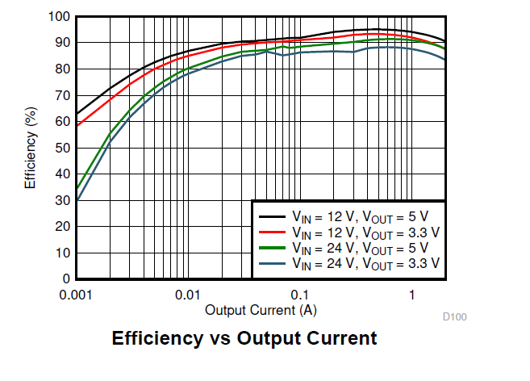
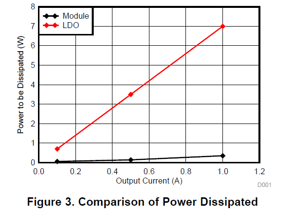
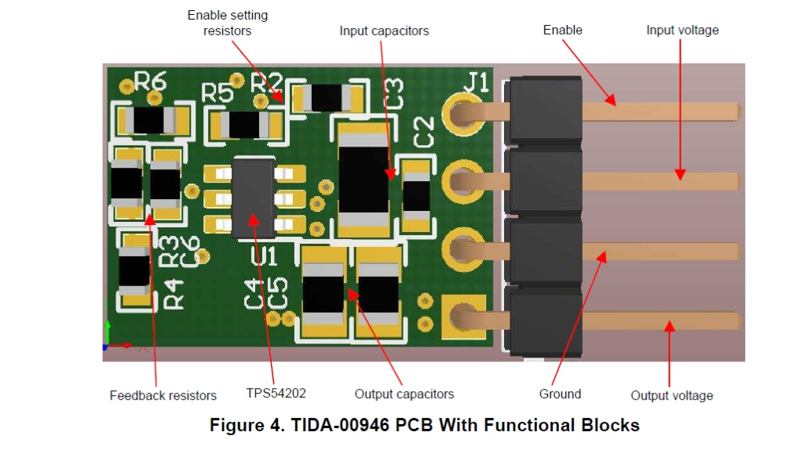
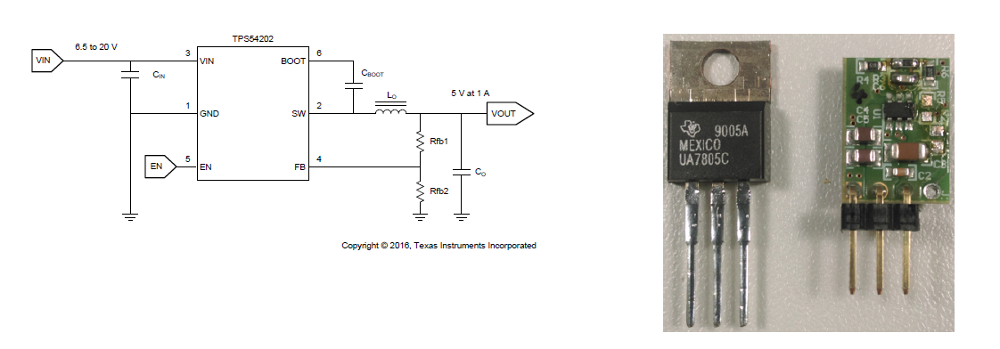

# Performans Analizi ve Baskılı Devre Kartı Tasarımı (Performance Analysis and PCB Layout)

Bu bölümde, bileşenlerin ve iç yapının analizinden sistemin fiili performansını değerlendirmeye geçiyoruz. Bu tasarımın (Switching Regulator) geleneksel doğrusal (linear) çözümlere kıyasla termal üstünlüğünü ve enerji verimliliğini kanıtlayan grafik eğrilerini inceleyecek, ardından bu tasarımın pratik bir baskılı devre kartına (PCB) nasıl dönüştürüldüğünün analizine geçeceğiz.

## 1. Performans Analizi: Verimlilik ve Güç Dağılımı (Efficiency & Power Dissipation Analysis)

### 1.1. Çıkış Akımına Karşı Verimlilik Eğrisi (Efficiency vs. Output Current)

Birinci grafik, TPS54202 entegresinin farklı akımlar çekildiğindeki verimlilik (Efficiency %) eğrisini, çeşitli giriş gerilimlerini (12V ve 24V) karşılaştırarak göstermektedir. Bu eğriyi mühendislik açısından okuyarak şu sonuçları çıkarabiliriz:
- **Orta ve Yüksek Yüklerde Üstün Verimlilik:** (0.1A ile 1A) arasında bir akım çekildiğinde verimliliğin %90 barajını aştığını ve yaklaşık %95'e ulaştığını görüyoruz. Bu, kaynaktan çekilen enerjinin %95'inin fiilen yükü (kamera veya mikrodenetleyici gibi) çalıştırmaya gittiği, sadece %5'inin ısı olarak kaybolduğu anlamına gelir.
- **Giriş Geriliminin ($V_{IN}$) Etkisi:** Eğri, giriş ve çıkış arasındaki gerilim farkı daha az olduğunda verimliliğin en yüksek seviyelerde olduğunu açıkça göstermektedir (siyah çizgi olan $12V$'tan $5V$'a dönüşüm, yeşil çizgi olan $24V$'tan $5V$'a dönüşümden daha üstündür). Bu durum, yüksek gerilimlerde artan anahtarlama kayıpları (Switching Losses) nedeniyle düşürücü dönüştürücülerde (Buck Converters) beklenen doğal bir olgudur.
- **Hafif Yük Verimliliği (Light Load Efficiency):** İç yapıda açıkladığımız (Pulse Skip / Eco-Mode) bloğu sayesinde entegre, çok düşük (miliamper düzeyinde) akımlar çekildiğinde bile nispeten iyi bir verimliliği korur, bu da onu uzun süre bekleme (Standby) modunda kalan sistemler için ideal hale getirir.

### 1.2. Termal Dağılım Karşılaştırması (Power Dissipation Comparison)

İkinci grafik, güç kaynağı tasarımındaki en önemli mühendislik gerçeklerinden birini, yani anahtarlamaya dayalı tasarımımız (Module) ile geleneksel doğrusal regülatör (LDO, ünlü 7805 entegresi gibi) arasındaki "ısı olarak kaybedilen güç" (Power Dissipated) karşılaştırmasını göstermektedir.
- **Doğrusal Regülatörün (LDO) Termal Çöküşü:** Kırmızı çizgi doğrusal regülatörü (LDO) temsil eder. İlişkinin doğrusal ve çok keskin olduğuna dikkat edin; çıkıştan (1A) akım çekildiğinde, doğrusal regülatör ($7 Watts$) değerine ulaşan devasa bir termal enerji (ısı) yayar! Bu ısı, çip devasa bir alüminyum soğutucuya ve soğutma fanına bağlanmazsa çipi eritebilir ki bu da projenin boyutunu, ağırlığını ve maliyetini mantıksız bir şekilde artırır.
- **Anahtarlamalı Modülün (Module) Mutlak Üstünlüğü:** Buna karşılık, siyah çizgi (TPS54202) tabanlı tasarımımızın termal performansını göstermektedir. Aynı akım (1A) çekildiğinde, ısı olarak yayılan güç neredeyse yok denecek kadar azdır ($0.5 Watts$'tan az).
- **Mühendislik Sonucu:** Termal kayıptaki bu muazzam fark, kartımızın çok küçük bir boyutta ve hiçbir ek soğutucuya (Heatsink) ihtiyaç duymadan tasarlanmasına olanak tanıyan şeydir. Bu durum onu, işlemcilerin yakınında yüksek ısı kaynaklarının bulunmasını tolere edemeyen gömülü sistemlere ve yapay zeka projelerine entegre etmek için ideal ve güvenilir bir çözüm haline getirir.

## 2. Pratik Baskılı Devre Kartı Tasarımı (PCB Layout and Form Factor)

Termal ve elektriksel verimliliği kanıtladıktan sonra, son mühendislik zorluğu olan Baskılı Devre Kartı (PCB) tasarımına geçiyoruz. Yüksek frekanslı (örneğin 500kHz) anahtarlama devrelerinde, bileşenleri sadece birbirine bağlamak yeterli değildir; bileşenlerin fiziksel yerleşimi (Physical Placement) tasarımın başarısının ayrılmaz bir parçasıdır.

### 2.1. Bileşenlerin Geometrik Dağılımı (Functional Blocks Placement)

Yukarıdaki görsel, değerlendirme kartının mühendislik şemasını (PCB layout) göstermektedir. Önceki bölümlerde çıkarılan tasarım kurallarının (Layout Guidelines) titizlikle uygulandığını görebiliriz:
- **Giriş Kondansatörlerinin Yerleşimi (Input Capacitors):** Kondansatörlerin ($C_2$ ve $C_3$), `TPS54202` (U1) entegresinin giriş (`VIN`) ve toprak (`GND`) pinlerine fiziksel olarak mümkün olan en yakın mesafeye yerleştirildiğini görüyoruz. Bu kritik yerleşim, bakır yollardaki parazitik endüktansı (Parasitic Inductance) azaltmayı garanti ederek anahtarlama işleminden kaynaklanan çınlamayı ve yüksek frekanslı gürültüyü (High-Frequency Noise) sönümler.
- **Geri Besleme Yolunun İzolasyonu (Feedback Loop Isolation):** Geri besleme ağı dirençleri ($R_3$, $R_4$, $R_6$) ve kondansatörü ($C_6$), elektromanyetik olarak gürültülü olan "anahtarlama düğümü" (SW Node) bölgesinden uzağa, kartın en solunda bir araya getirilmiştir. Bu, çıkış gerilimini okuyan zayıf ve hassas analog sinyali elektromanyetik kirlilikten korur.
- **Kompakt Tasarım (Compactness):** Çift çıkış kondansatörleri ($C_4$ ve $C_5$) ve etkinleştirme ayar dirençleri ($R_2$ ve $R_5$) dahil olmak üzere tüm bileşenler, mükemmel bir güç yoğunluğunu (Power Density) yansıtacak şekilde birkaç santimetrekareyi geçmeyen fiziksel bir alana yerleştirilmiştir.

### 2.2. Uyumluluk ve Doğrudan Değiştirme (Drop-in Replacement)

Bu görsel, bu tasarımdaki tüm mühendislik çabalarının zirvesi niteliğinde olup, en önemli uygulama ve ticari hedefini vurgulamaktadır:
- **Standart Form Faktörü Eşleşmesi (Form Factor Match):** Görselin sağ tarafı, kendi tasarımımızın (Switching Module) baskılı devre kartını ve onun yanında (UA7805C) entegresi gibi ünlü standart (TO-220) kılıfına sahip (78xx) ailesinden geleneksel bir doğrusal regülatörü göstermektedir. Kartımız, boyutları ve bakır bağlantı pinlerinin mesafesi (Pin Pitch) açısından bu eski standartla tam olarak uyumlu olacak şekilde tasarlanmıştır.
- **Anında Yükseltme Konsepti (Drop-in Replacement):** Mühendislik açısından bu, enerji israf eden doğrusal regülatörlere dayanan eski sistemlerin (eski anakartlar veya önceki projeler gibi), tüm anakartı yeniden tasarlamaya gerek kalmadan anında yükseltilebileceği anlamına gelir. Ekteki basitleştirilmiş şemada gösterildiği gibi, eski (TO-220) regülatör sökülür ve (1A'da 5V) güç sağlamak üzere bu akıllı anahtarlamalı kart doğrudan onun yerine lehimlenir.
- **Soğutucuların Ortadan Kaldırılması (Heatsink Elimination):** Görselde görünen doğrusal regülatör (UA7805C), ısıyı dağıtmak için büyük bir alüminyum parçaya bağlanmak üzere üstünde metal bir delik barındırır. Daha önce kanıtladığımız (TPS54202) entegresinin verimliliği sayesinde, herhangi bir soğutucuya olan ihtiyaç tamamen ortadan kalkmış, bu da proje kasasında (Enclosure) geniş bir alan tasarrufu sağlamış ve toplam ağırlığı önemli ölçüde azaltmıştır.

## 3. Performans ve Pratik Tasarımın Kapsamlı Özeti (Comprehensive Performance and Layout Summary)
Bu bölümün sonunda, performans analizi ve baskılı devre kartı tasarımı; (TPS54202) entegresini benimsemenin, sadece geleneksel bir gerilim düşürmenin ötesine geçen entegre bir mühendislik çözümü olduğunu ve çeşitli yönlerden açık bir üstünlük sağladığını göstermektedir:

1. **Üstün Termal Verimlilik (Thermal Efficiency):** Enerji harcayan doğrusal regülasyon (LDO) yerine anahtarlamalı mod (Switch-mode) teknolojisi kullanılarak termal israf tamamen ortadan kaldırılmış, bu da soğutuculara (Heatsinks) olan ihtiyacı iptal etmiş ve sistemin ömrünü ve güvenilirliğini artırmıştır.
2. **Elektromanyetik Girişim Bağışıklığı (EMI Immunity):** Bileşenlerin baskılı devre kartı üzerindeki hassas geometrik dağılımı (giriş kondansatörlerinin fiziksel olarak yakınlaştırılması ve geri besleme yolunun izole edilmesi gibi), Sinyal Bütünlüğü (Signal Integrity) kurallarına sıkı sıkıya uyulduğunu ve parazitik empedansların en aza indirildiğini kanıtlamıştır.
3. **Uygulama Esnekliği ve Uyumluluk (Drop-in Replacement):** Standart (TO-220) boyutlarıyla uyumlu kompakt tasarım, bu baskılı devre kartının herhangi bir sisteme kolayca entegre edilmesini veya değiştirilmesini sağlar. Bu durum, onu boyut veya toplam ağırlık üzerinde hiçbir etki yaratmadan bu projedeki (izleme kameraları ve yapay zeka sistemi gibi) hassas yükleri beslemek için ideal ve güvenilir bir seçim haline getirir.

> **Belgelendirme Notu:** Bu dosya ile güç devresinin donanım tasarımına ait analitik, fiziksel ve mimari boyut tamamlanmaktadır. Belirtilen tüm fiziksel seçimler, `Calculations` klasörü altındaki özel hesaplamalar belgesinde denklemlerle ayrıntılandırılacak ve kanıtlanacak olan matematiksel temellere dayanmaktadır.