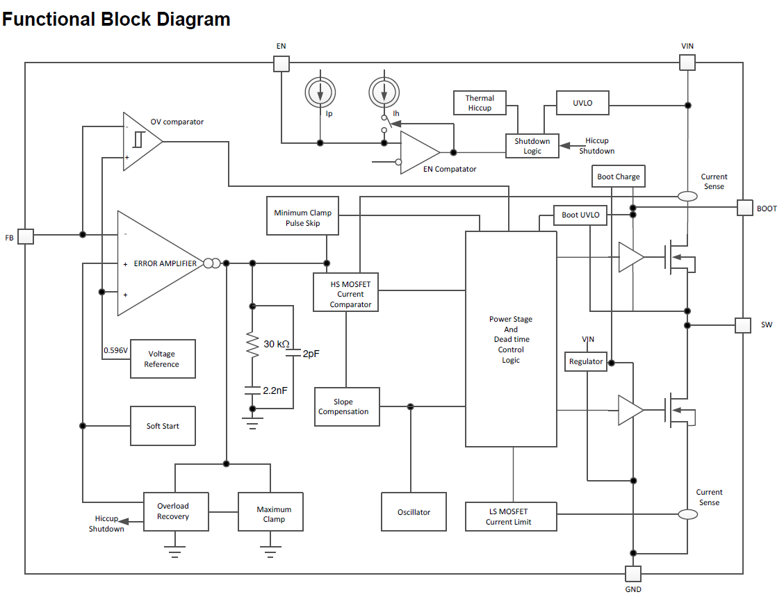

# Architectural Analysis and Internal Structure (Internal Architecture and Block Diagram)

After completing the comprehensive analysis of the external circuitry design and understanding the functional role of the peripheral components in filtering, smoothing, and protecting the system, we now dive into the architectural depths of the silicon chip itself (TPS54202).

## 1. Functional Block Diagram

The block diagram above illustrates the internal architecture or the "mastermind" of the IC. The role of this chip is not merely limited to housing the switching transistors (MOSFETs); rather, it encompasses a complete Closed-Loop Control System that manages the voltage regulation process with high efficiency and makes instantaneous decisions based on feedback.

To thoroughly understand the operational mechanism of this converter from an engineering perspective, this complex diagram must be broken down into fundamental Functional Blocks. In the following sections, we will explore the comparator circuits, the Error Amplifier, the Oscillator, and the Protection Logic units that ensure system stability under the harshest operating conditions.

### 2.1. Feedback Path, Error Amplifier, and Initial Protection Systems
Intelligent control in this IC begins at the Feedback (FB) pin, which represents the critical link between the external output of the circuit and the internal brain of the chip. The analog signal arriving from this pin splits into two main paths for control and protection: the regulation path via the "Error Amplifier," and the fast protection path via the "Over-Voltage Comparator."

#### 1. Error Amplifier and Reference Voltage
*   **Function and Engineering Role:** The Error Amplifier is the beating heart of the closed-loop control system. This amplifier receives the voltage from the (FB) pin at its inverting (negative) input and compares it to an ultra-precise internal Voltage Reference of ($0.596V$) connected to its non-inverting (positive) input. If the external output voltage drops, the amplifier magnifies this "error" (the difference between the two values) and sends a strong control signal to increase the pulse width (Duty Cycle).
*   **Internal Silicon Design Examples:** This block is typically designed as an Operational Transconductance Amplifier (OTA). To ensure the stability of this amplifier and prevent rapid system oscillation, we notice an Internal Compensation Network in the diagram, consisting of a ($30 k\Omega$) resistor and a ($2.2 nF$) capacitor. Integrating this network into the silicon saves the external designer from the burden of calculating and adding complex compensation components.

#### 2. Soft Start Unit
*   **Function and Engineering Role:** This block is connected to the Error Amplifier, and its function is to prevent a massive Inrush Current shock during startup. It gradually increases the virtual reference voltage from zero until it reaches the nominal value ($0.596V$). This ramping forces the output voltage to rise smoothly and softly, thereby protecting external components.
*   **Internal Silicon Design Examples:** The Soft Start block is internally designed via a Constant Current Source that charges a small-capacity internal silicon capacitor. The charging process of this capacitor generates a linearly rising Ramp Voltage. This rising voltage is fed to the Error Amplifier as a temporary substitute for the fixed reference voltage until the startup is complete.

#### 3. Maximum Clamp
*   **Function and Engineering Role:** The output signal of the Error Amplifier dictates the "maximum current" the inductor is allowed to draw at that given moment. In the event of a severe Short Circuit at the output, the feedback voltage will drop to zero, and the Error Amplifier will attempt to drive its signal to infinity to compensate for this deficit! Here, the Maximum Clamp block intervenes to set a "Maximum Ceiling" (Voltage Limit) for the Error Amplifier's output that cannot be exceeded. This ceiling physically translates to a "Peak Current Limit" permitted to flow through the MOSFETs, protecting them from instant burnout.
*   **Internal Silicon Design Examples:** This block is usually designed using an Active Clamp (BJT/MOSFET) circuit programmed to act as a safety switch. Once the amplifier's output reaches the maximum allowed threshold, this transistor turns on to "Sink" any additional voltage or current and route it to the Ground (GND).

#### 4. Overload Recovery and Hiccup Shutdown
*   **Function and Engineering Role:** This block acts as the final strategic line of defense. If the Error Amplifier continuously hits the Maximum Clamp ceiling for a sustained period, the chip realizes that this is not merely a temporary current draw, but a permanent fault or a dangerous Overload. This triggers the Hiccup Shutdown system, which completely disables switching to let the IC cool down, and then attempts a Recovery restart after a specified delay. If the fault is cleared, the IC resumes operation; otherwise, it shuts down again in an infinite loop to protect the system.
*   **Internal Silicon Design Examples:** This system is designed using a voltage comparator monitoring the Error Amplifier's output. If the node exceeds the clamp limit, the comparator sends an activation signal to a Digital Counter or an RC Timer circuit. This counter calculates the Hiccup Delay period before sending the shutdown or restart command to the central logic unit.

#### 5. Over-Voltage (OV) Comparator
*   **Function and Engineering Role:** This block represents the direct and rapid protection path. The comparator takes a sample from the (FB) pin and compares it to a voltage slightly higher than the reference voltage (typically 109% of the $0.596V$). If a large load is suddenly disconnected, the output voltage will spike dangerously. This comparator detects the sudden spike, bypassing the slower Error Amplifier, and sends a direct command to immediately halt switching, protecting the load from high-voltage burnout.
*   **Internal Silicon Design Examples:** It is designed using a High-Speed Open-Loop Comparator. One input is tied to the feedback signal, and the other to an internal voltage divider providing the high threshold. This design boasts a nanosecond response time since it does not pass through slow RC compensation networks.

#### 6. Oscillator and Slope Compensation
*   **Function and Engineering Role:** The internal Oscillator is the "conductor" that sets the timing rhythm for the chip's operation. It generates Clock Pulses at a fixed, pre-programmed frequency ($500kHz$ in the TPS54202). These pulses issue the "Turn ON" command to the High-Side MOSFET at the beginning of each cycle.
    The "Slope Compensation" block is a physical solution to a notorious problem in Current Mode Control circuits. When the Duty Cycle exceeds 50%, the system tends to enter a state of instability known as "Sub-harmonic Oscillation," where pulses oscillate chaotically. This block steps in to add an Artificial Ramp signal to the actual current signal, forcing the control loop to remain stable regardless of how high the duty cycle gets.
*   **Internal Silicon Design Examples:** The oscillator is typically designed as a microscopic RC Relaxation Oscillator within the silicon, relying on charging and discharging a precise capacitor with a constant current to achieve a temperature-independent frequency. The Slope Compensation block is designed using an analog Summing Amplifier that combines the oscillator signal (sawtooth waveform) with the actual current signal.

#### 7. High-Side (HS) MOSFET Current Comparator
*   **Function and Engineering Role:** This block is the true nerve center of the control system. If the oscillator determines "when to turn ON" the high-side transistor, this comparator determines **"when to turn OFF"**!
    This comparator simultaneously monitors two currents:
    1. The actual current flowing through the High-Side transistor (which rises gradually).
    2. The control signal coming from the Error Amplifier, added to the slope compensation.
    As soon as the rising actual current reaches the value demanded by the Error Amplifier, this comparator sends an instantaneous signal to the central logic unit commanding it to immediately Turn OFF the high-side transistor. This mechanism ensures an ultra-fast, Cycle-by-Cycle response to changes in input or load.
*   **Internal Silicon Design Examples:** A traditional, bulky Sense Resistor is not used because it wastes power. Instead, this block is designed using "Current Mirror" technology or a miniature SenseFET, which passes a tiny fraction of the current (e.g., 1/1000) to a high-speed analog comparator that measures the voltage without any power dissipation.

#### 8. Minimum Clamp Pulse Skip
*   **Function and Engineering Role:** This block is dedicated to boosting the circuit's efficiency during "Light Load Conditions". When the device is in Standby mode, current draw drops significantly, and the Error Amplifier demands a very small Duty Cycle. The problem is that transistors have a Minimum On-Time that cannot be violated.
    If the demand drops below this time, the Minimum Clamp Pulse Skip block intervenes to prevent the IC from sending extremely short, distorted pulses. Instead, it forces the chip into "Pulse Skipping" (or Eco-Mode). The chip pumps one pulse, then sleeps for several cycles until the output voltage drops, then wakes up to pump another pulse, miraculously reducing Switching Losses.
*   **Internal Silicon Design Examples:** This block is designed as a Lower Threshold Comparator connected to the Error Amplifier's output. If the control voltage drops below a minimum reference value (e.g., $0.4V$), the comparator sends a digital "Disable" signal to the oscillator and the transistor gate, forcing it to pause switching temporarily.

#### 9. Power Stage And Dead Time Control Logic
*   **Function and Engineering Role:** This large box in the center of the diagram is the ultimate "Executive Brain". All previous blocks (comparators, Error Amplifier, protection systems like UVLO and Hiccup) funnel their signals here. The function of this unit is to process all these digital signals and issue the final command to the output transistors (HS MOSFET and LS MOSFET).
    The most critical function here is **"Dead Time"** management. In synchronous converters, a true disaster occurs if the high-side and low-side transistors turn on simultaneously (causing a direct short circuit between supply and ground known as Shoot-through). This unit guarantees the addition of a nanosecond-level Dead Time; it turns off the first transistor, waits for a precise delay to ensure it is fully off, and then turns on the second transistor.
*   **Internal Silicon Design Examples:** This block is pure Digital Logic. It consists of logic gates (NAND / NOR) and SR Flip-Flops acting as momentary pulse state memory. The Dead Time section is designed via "Delay Lines" relying on a cascaded series of Inverters to slow down the signal by a highly precise, fixed, and engineered time duration.

### 2.2. Power Stage, Gate Drivers, and Current Sensing
The right section of the block diagram represents the "Executive Muscles" of the IC. This unit receives the digital ON/OFF commands from the Control Logic and translates them into high power currents to drive the load, while instantaneously monitoring the current to ensure safety.

#### 1. Power Transistors (HS & LS MOSFETs) and Gate Drivers
*   **Function and Engineering Role:** This block contains two primary N-Channel transistors:
    1. **High-Side (HS) MOSFET:** Connects the input supply (VIN) to the switching node (SW). When ON, it passes power to the inductor and load.
    2. **Low-Side (LS) MOSFET:** Connects the (SW) node to Ground (GND) and acts as a "Synchronous Rectifier" to pass the inductor current when the high-side MOSFET turns off, vastly improving efficiency compared to a traditional diode.
    Preceding these two transistors are **two triangular symbols**, representing the "Gate Drivers." Digital control signals are too weak to drive large transistor gates. These drivers pump a massive instantaneous current to charge and discharge the MOSFET gate capacitors at ultra-fast speeds.
*   **Internal Silicon Design Examples:** Gate Drivers are usually designed as a cascaded series of CMOS Inverters that progressively increase in size to handle high pulse currents. The transistors themselves are manufactured using LDMOS (Laterally Diffused MOSFET) technology integrated into the silicon, providing a very low On-Resistance (RDS-on) to minimize thermal losses.

#### 2. Internal Voltage Regulator (Regulator VIN)
*   **Function and Engineering Role:** The delicate logic circuits inside the chip cannot operate on high input voltages (which can reach 20V or more). Therefore, this internal regulator takes the (VIN) voltage and steps it down to a stable, low voltage (usually 5V or 3.3V) to power the chip's brain (Oscillator, Error Amp, Comparators) as well as the low-side transistor's gate driver.
*   **Internal Silicon Design Examples:** Designed as an LDO (Low Dropout Regulator) relying on a Bandgap Reference voltage and an operational amplifier controlling an internal pass transistor to guarantee internal voltage stability regardless of external input fluctuations.

#### 3. Boot Charge & Boot UVLO
*   **Function and Engineering Role:** For the High-Side MOSFET to operate properly, the voltage at its gate must be higher than its source (SW). This is why the external Bootstrap Capacitor is used.
    *   **Boot Charge:** This circuit charges the external capacitor. When the low-side transistor turns on, the voltage at the (SW) node becomes zero, allowing the Boot Charge path to pass current from the internal regulator to charge the capacitor connected to the (BOOT) pin.
    *   **Boot UVLO:** If the capacitor is not sufficiently charged, the high-side transistor will operate in the Linear Region, leading to overheating and burnout. The Boot UVLO block monitors the voltage difference between the (BOOT) and (SW) pins. If the voltage is below the safe threshold, it prevents the control unit from issuing the turn-on command to the high-side transistor.
*   **Internal Silicon Design Examples:** The Boot Charge block is often designed as an Integrated Schottky Diode handling high voltage with a small resistor to limit charging current. The Boot UVLO is an analog voltage comparator continuously measuring the differential.

#### 4. Current Sense and LS MOSFET Current Limit
*   **Function and Engineering Role:** We notice two loop symbols in the diagram representing "Current Sense," one for the high-side and one for the low-side transistor. These loops represent the instantaneous current measurement system.
    *   The high-side sensor's signal goes to switching control (as explained earlier in the current comparator).
    *   The low-side sensor sends its signal to the (LS MOSFET Current Limit) block. Its function is highly critical: during a severe short circuit, current can build up inside the inductor and become extremely dangerous. This block monitors the current passing through the low-side transistor during the OFF period. If the accumulated current is above the allowed limit, this block sends a command to the central control logic to "prevent the high-side transistor from turning on in the next cycle" until the excess inductor current dissipates, thereby preventing "Current Runaway."
*   **Internal Silicon Design Examples:** Traditional large sense resistors are not used as they would dissipate massive energy. Architecturally, this section is designed using "SenseFET" technology. A tiny percentage of the silicon cells making up the main transistor is isolated (e.g., 1 cell out of 10,000) and its microampere current is routed through an internal measurement resistor. The generated voltage perfectly mirrors the total current and is sent to the comparators for decision-making.

### 2.3. Enable, Thermal Protection, and Shutdown Logic
The upper section of the diagram represents the "Sovereign Safety" network of the IC. These blocks are responsible for making the "life or death" (Turn ON or Shutdown) decision for the entire converter based on the integrity of the power supply (VIN), user control signal (EN), and the actual die temperature.

#### 1. Enable Pin (EN) and Hysteresis Current Sources ($I_p$ and $I_h$)
*   **Function and Engineering Role:** The `EN` pin's role is not limited to being a simple power switch. In the diagram, it is connected to two internal current sources: a Pull-up Current ($I_p$) and a Hysteresis Current ($I_h$).
    These two sources are the secret behind the operation of the external resistor network (analyzed previously in the practical schematic). When the voltage on the `EN` pin is below the turn-on threshold, a baseline current flows. Once the voltage crosses the threshold and startup begins, the second current source ($I_h$) activates, pumping additional current into the lower external resistor. This instantaneous current injection causes a sudden voltage jump, creating a "Safe Voltage Gap" or "Hysteresis" that prevents the chip from shutting down immediately if a slight voltage drop occurs at the source.
*   **Internal Silicon Design Examples:** These sources are designed using highly precise analog "Current Mirrors" inside the silicon. This technology relies on physically identical transistors to mirror a constant reference current (usually in microamperes $\mu A$) and pump it completely independent of temperature or overall voltage fluctuations.

#### 2. EN Comparator
*   **Function and Engineering Role:** This analog comparator takes the actual voltage from the `EN` pin (after being influenced by the current sources) and compares it with an extremely precise internal reference voltage (about 1.2V in most power designs). If the input exceeds this threshold, the comparator issues a Logic HIGH signal to the shutdown unit, notifying it that the user permits operation to begin.
*   **Internal Silicon Design Examples:** Designed as a High-Speed Op-Amp Comparator internally equipped with a Positive Feedback network. This design ensures a clean, sharp logic transition from zero to one, even if the voltage from the external resistor divider rises very slowly.

#### 3. Under-Voltage Lockout (UVLO)
*   **Function and Engineering Role:** This block is fundamentally different from the `EN` protection. It directly and autonomously monitors the main `VIN` supply pin. From an engineering standpoint, even if the `EN` pin is active and requesting startup, the sensitive analog circuits inside the chip (like the oscillator and error amplifier) cannot function stably if the total supply voltage is below the minimum safe operating limit (e.g., below 4V). The UVLO block intervenes to "veto" and prevent the system from starting in the event of a weak source.
*   **Internal Silicon Design Examples:** Built using an entirely silicon-integrated resistor voltage divider that samples `VIN` and compares it to a Bandgap Reference. It features a fixed internal hysteresis to prevent annoying, repetitive on/off cycling during battery fluctuations or a weak power source.

#### 4. Thermal Hiccup
*   **Function and Engineering Role:** Heat is the deadliest threat to semiconductor survival. This block monitors the internal Die Temperature itself, moment by moment. If the temperature reaches a catastrophic limit (typically 165°C), it issues a decisive command for immediate Thermal Shutdown.
    The integrated "Hiccup" system ensures the circuit will not attempt to restart the moment the temperature drops by a single degree. Instead, it forces the IC to wait until the temperature drops by a significant margin (e.g., down to 145°C) before allowing a restart, preventing a slow-burn scenario.
*   **Internal Silicon Design Examples:** This block is designed as an integrated thermal sensor known as PTAT (Proportional to Absolute Temperature). The sensor relies on the fixed physical properties of a PN Junction in an integrated BJT transistor, where the Base-Emitter voltage ($V_{BE}$) drops at a precise, constant mathematical rate (around $-2mV/^{\circ}C$) for every degree of temperature rise. This voltage drop is read by a comparator to issue the shutdown command.

#### 5. Shutdown Logic and Hiccup Shutdown
*   **Function and Engineering Role:** This block acts as the "Supreme Court" for safety-related digital signals in the chip. It aggregates signals from the `EN` comparator, `UVLO` sensor, `Thermal Hiccup` block, and over-current protection systems. If a "Fault Signal" (red flag) arrives from any of these sources, this logic unit completely severs the signal to the Power Stage Logic, abruptly halting switching pulses and isolating the load to protect it.
    The associated Hiccup Shutdown mechanism guarantees intelligent behavior during a Short Circuit: Instead of continuing to supply high current leading to burnout, this logic puts the chip to sleep, then releases extremely short, widely spaced test pulses (like hiccups). If the short is removed, the system recovers; otherwise, it remains in this safe mode.
*   **Internal Silicon Design Examples:** This circuit is pure Digital Logic. It is constructed using a matrix of OR Gates to unify fault sources, linked to an SR Latch memory to hold the fault state. The Hiccup section includes a Digital Counter that derives its pulses from the internal oscillator to calculate precise delay cycles (e.g., 512 clock cycles) before permitting the next startup attempt.

## 3. Comprehensive Architecture Summary
By deconstructing the internal block diagram of the TPS54202 chip, it becomes evident that this IC is not merely a voltage switching key, but a "Smart, Miniature Power Management System".

This advanced silicon design guarantees two primary objectives:
1. **Precise and Stable Regulation:** Via a fast-response control loop relying on a highly accurate error amplifier, cycle-by-cycle instantaneous current comparators, and a fixed oscillator that precisely regulates power consumption and adapts to light loads via pulse skipping.
2. **Absolute Reliability and Safety:** Through a complex, multi-layered protection network (UVLO, thermal protection, current limiting, and the Hiccup shutdown system). This network autonomously intervenes as a final line of defense to protect both the chip itself and the connected load.

The presence of this level of internal intelligence is what makes this converter the optimal engineering choice for powering complex and sensitive systems, even under the worst conditions of electrical instability.